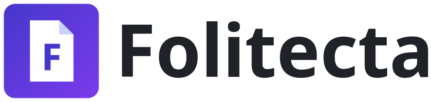
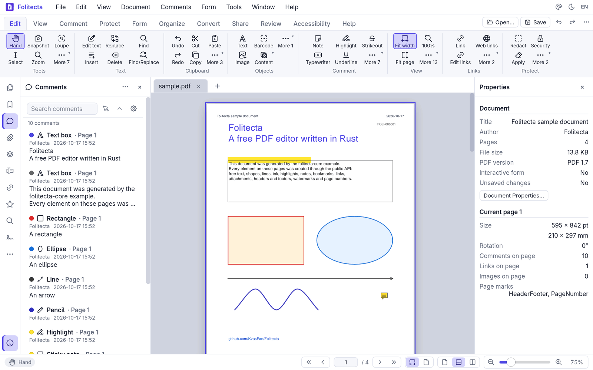
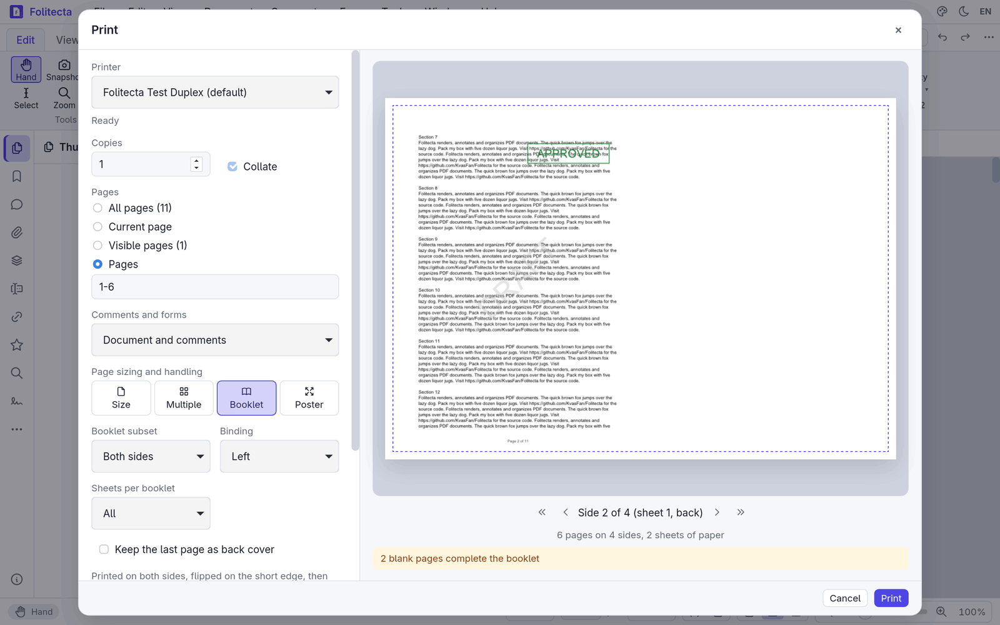
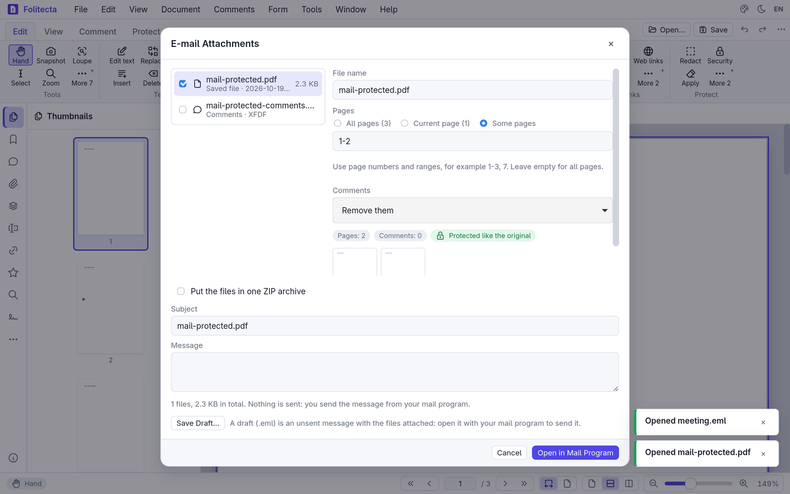
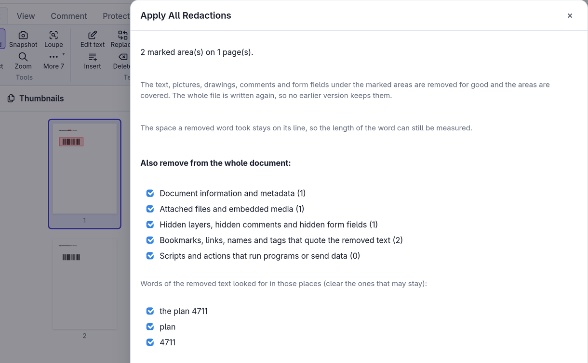
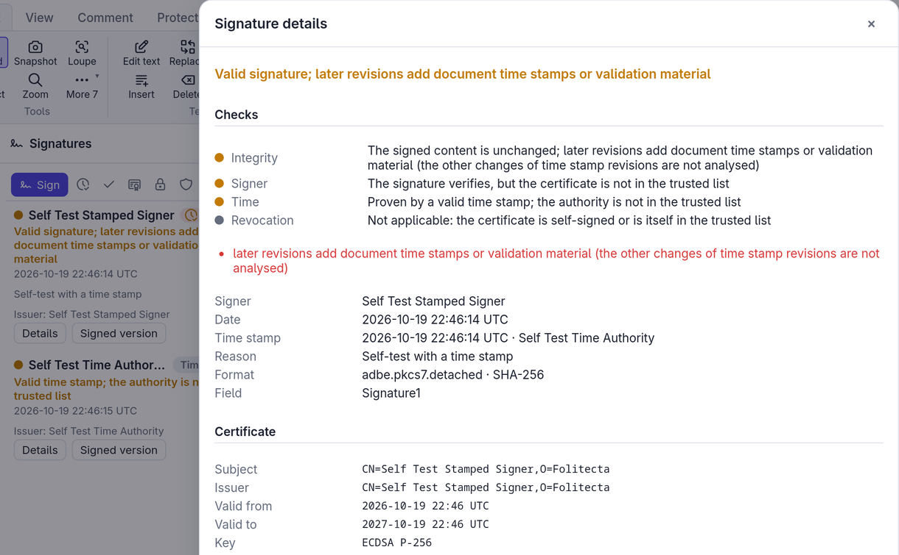
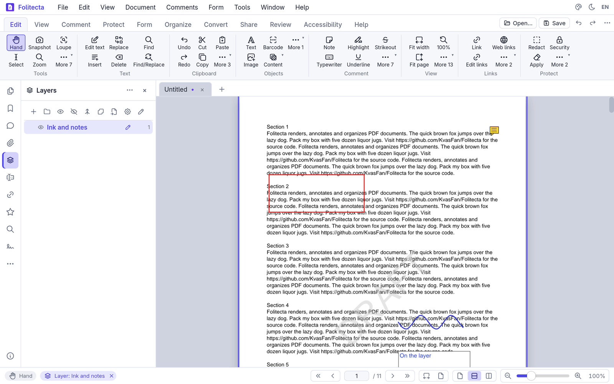
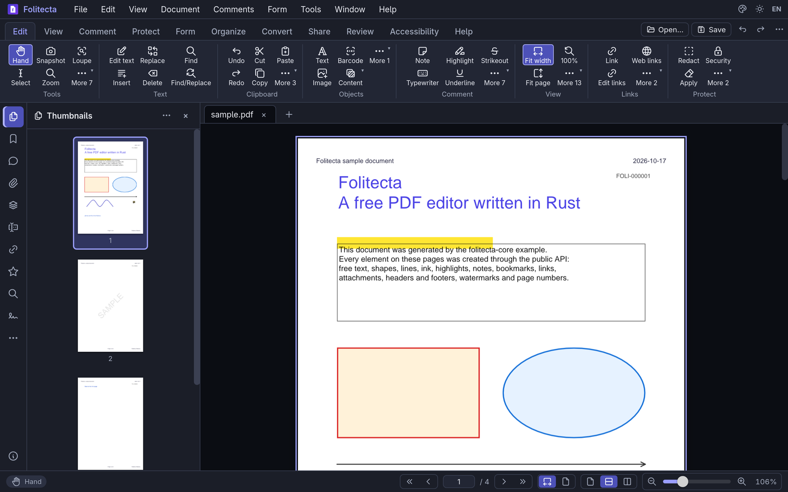

<p align="center">
  <picture>
    <source media="(prefers-color-scheme: dark)" srcset="docs/brand/folitecta-logo-white.png">
    
  </picture>
</p>

<h1 align="center">Folitecta</h1>

<p align="center">
  <b>A free PDF editor written in Rust, with a desktop interface for Windows, Linux and macOS.</b>
</p>

<p align="center">
  Read, comment, fill, sign, protect, redact, organize and print PDF documents. Folitecta draws
  pages with the pure-Rust <a href="https://github.com/LaurenzV/hayro">hayro</a> rasterizer, edits
  them through the <a href="https://github.com/J-F-Liu/lopdf">lopdf</a> object model and shows them
  in a <a href="https://dioxuslabs.com">Dioxus</a> interface with a ribbon or classic menus.
  Free software under the MIT License, with no account and no subscription.
</p>

<p align="center">
  
  
  
  <a href="https://github.com/KvasFan/Folitecta/releases"></a>
  
</p>

<p align="center">
  <a href="#screenshots">Screenshots</a> ·
  <a href="#why-folitecta">Why Folitecta</a> ·
  <a href="#what-works-today">What works today</a> ·
  <a href="#downloads">Downloads</a> ·
  <a href="#building-from-source">Building from source</a> ·
  <a href="#architecture">Architecture</a> ·
  <a href="#roadmap">Roadmap</a> ·
  <a href="#license-and-credits">License and credits</a>
</p>

<br>

<p align="center">
  
  <br><sub><b>Comments</b> (<a href="docs/sample.pdf">docs/sample.pdf</a>): every comment of the document in the Comments pane, the document and the current page in the Properties pane, the Edit tab of the ribbon above.</sub>
</p>

> [!NOTE]
> **Folitecta 0.3.1 is a pre-release.** Every command of the full feature set is already in the
> interface; each release turns more of them into working operations, and the ones that are not
> done yet open a roadmap notice. [docs/FEATURES.md](docs/FEATURES.md) lists the state of every
> command; the limits of what works are written below and in
> [docs/ARCHITECTURE.md](docs/ARCHITECTURE.md).

## Screenshots

<table>
  <tr>
    <td width="50%"></td>
    <td width="50%"></td>
  </tr>
  <tr>
    <td><sub><b>Print window</b>: pages 1–6 laid out as a booklet; the preview shows side 2, the back of sheet 1, and says that two blank pages complete the booklet. The printer is the stand-in of the self-test.</sub></td>
    <td><sub><b>E-mail attachments</b>: pages 1–2 of a protected document, its comments removed, prepared in the background with their size and first pages; the copy stays protected like the original, and Folitecta itself sends nothing.</sub></td>
  </tr>
  <tr>
    <td></td>
    <td></td>
  </tr>
  <tr>
    <td><sub><b>Applying redaction</b>: what goes, the warning that the length of a removed word can still be measured, and what is also removed from the whole document, with the words of the removed text that are looked for.</sub></td>
    <td><sub><b>Signature details</b>: integrity, signer, time and revocation checked separately, here for a self-test signature with a time stamp whose certificates are not in the trusted list.</sub></td>
  </tr>
  <tr>
    <td></td>
    <td></td>
  </tr>
  <tr>
    <td><sub><b>Layers</b>: the layer selected in the Layers pane receives what is drawn and written; the ink stroke and the text box are on it, and the status bar names it.</sub></td>
    <td><sub><b>Dark theme</b>: one of the four themes (light, white, dark, black), here with the Thumbnails pane.</sub></td>
  </tr>
</table>

## Why Folitecta

- **The whole command surface.** 1,981 commands in a ribbon of 11 tabs, 9 classic menus, side
  panes and a command palette (`Ctrl+Shift+P`), so the full feature set is in place and can be
  found. More than 1,400 of them work today; the state of each one is in
  [docs/FEATURES.md](docs/FEATURES.md), generated from the code, and in the in-app
  **Feature matrix** dialog.
- **Rust from end to end.** Folitecta's own code is Rust, and so are the libraries that read,
  draw, edit, sign, encrypt and recognize documents. It runs as a desktop program on Windows,
  Linux and macOS; the interface uses the web view the system already has (WebView2, WebKitGTK,
  WKWebView), so no browser engine is bundled, and secure connections use the system's TLS
  library.
- **Your files are kept safe.** Every save goes to a temporary file that replaces the original
  only once it is complete and checked. A protected file is saved again with its encryption,
  passwords and permissions; new protection uses AES-256; signing, certifying or time-stamping a
  protected document keeps it encrypted, as an encrypted update that keeps the earlier signatures
  valid.
- **Honest about its state.** Commands that are not done yet say so instead of doing part of the
  job silently, reduced versions are marked as partial, and the known limits are written down.
- **Free.** MIT License, no account, no subscription. Apart from printing to the computer's print
  server, Folitecta connects only to the time stamp server you set and, when you turn online
  revocation checks on, to the addresses written in the certificates.

## What works today

Version 0.3.1. The parts marked *new in 0.3.0* came with 0.3.0, which 0.3.1 completes with
shorter menus and a pencil pointer of the right size on Linux; everything else was already in
0.2.1.

| Area | Status |
|---|---|
| Viewing | Tabs; continuous, single-page and two-page layouts; fit width, fit page and free zoom (`Ctrl`+wheel); view rotation; a split window with two views of a document; tabs in two groups side by side or one above the other, each with its tab strip, and a document moved to a new window (*new in 0.3.0*); full screen; light, white, dark and black themes; dark and high-contrast page modes; rulers (mm, cm, in, pt, pc), grid and guides with snapping; a loupe with adjustable enlargement; a pan and zoom window; the visible area outlined on the thumbnails; link and form-field highlighting; transparency grid; document info bar; page labels; view history; a reflow view with the text of the document in the width of the window, at a size of one's choosing (*new in 0.3.0*); reading aloud with the voices of the system, paragraph by paragraph, the one read marked (*new in 0.3.0*) |
| Interface | Ribbon or classic menus and toolbars that adapt to any window size; menus kept short, with the commands used most at the top and the others in submenus by subject; short tool names under the ribbon icons (View › Tool Names hides them) and the whole names in the tooltips; a Quick Access Toolbar of your own commands (a right click on a tool adds it), next to the tabs or below the ribbon; side panes, ribbon rows and the width of each ribbon group changed by dragging their edges; properties pane; touch mode; command palette; undo and redo of every edit; pages drawn on several threads; recovery of documents after a window ended with unsaved changes; English and Italian |
| Large documents | Faster scrolling and zoom: pages are drawn in the order the window needs them, in tiles when zoomed in, and scrolling never waits for the program |
| Text and search | Text layer with mouse selection, copy and select all; search with match case, whole words and accents ignored, words near each other (adjacent, same paragraph, page or document) in separate colours, also in comments, bookmarks, form fields, document information, attachments and links, or through the PDF files of a folder; grouped results with previous and next (`F3`); every result marked as highlight, underline, strikeout or redaction; word count; export to `.txt` |
| Page text | The Edit Text tool and the Insert, Replace and Delete Text commands of Edit › Text change the text drawn on the page (the rest of the line moves to make room); Find and Replace changes one occurrence or all of them in one undo step |
| Text recognition (OCR) | Scanned pages, only the pictures in the pages, or an area read with PaddleOCR models run in pure Rust; English, Italian and 30 more languages of the Latin script. The text is written invisibly over the pages, so they can be searched and their text selected and copied; pictures can be made into a searchable document. Pages are read in the background with a progress bar and can be stopped; words read with doubt are then checked one by one, each shown with its picture, to correct, keep or remove (*new in 0.3.0*) |
| Spelling | Spell Check and Replace goes through the words of the page text, comments and form fields that the dictionaries do not know (English and Italian included, more Hunspell dictionaries can be added, several languages at once), with suggestions, change once or everywhere, ignore once or everywhere, and your own words; misspelled words are marked on the page while its text is edited |
| Comments | Sticky notes (eleven icons), text boxes, callouts, typewriter text, rectangles, ellipses, polygons, polylines, clouds, lines, arrows (shown as they will look while drawn), smooth pencil strokes with eraser, area and free highlights, text highlight, underline and strikeout, insert-text and replace-text marks and text correction, stamps (presets, custom text, images), file attachments, links (web address, page, named destination, file to open, script), each with a generated appearance. Style editor (colour, fill, opacity, thickness, dashes, line endings, text size and alignment) with per-tool defaults, named comment styles with a palette, style copy and paste. Select, move and resize with handles, nudge with the arrow keys, choose several with Shift to move, align, distribute, size alike and stack them, group them, copy, cut and paste across documents, flatten one or all, hide and show, delete. Text boxes, typewriter text, callouts and measurement labels take characters beyond Western European ones (Polish, Czech, Greek, Cyrillic, symbols, …), drawn with an embedded subset of GNU FreeFont FreeSans, so the text shows, prints and can be copied and found; text that cannot be drawn yet (right to left, joining or combining letters, characters the font lacks) is refused before any change, with the characters named |
| Review | Replies, review states with history, check marks, filters, pop-up notes, comment summaries, export and import of comments as XFDF, FDF or PDF |
| Layers | Visibility in the view, defaults, groups, merge, flatten, extract, import. With a layer selected in the Layers pane or with Edit › Choose Layer, new comments, placed pictures and barcodes go to that layer, and the status bar shows it (Default Layer stops it); Choose Layer, the Layer field of the comment properties and Move to New Layer move comments between layers; the comments of a hidden layer are hidden on the pages, the thumbnails and in the Comments pane |
| Sign | Digital signatures and certification with PKCS#12 digital IDs (RSA, ECDSA) and self-signed IDs; validation against trusted certificates with separate checks of integrity, signer, time and revocation; time stamps (RFC 3161) of signatures and document time stamps from a time stamp server; incremental saving that keeps signatures valid; handwritten signatures and initials from a library. Revocation is checked from the OCSP answers and revocation lists in the signature, its time stamp or the document security store, or fetched online (off until you turn it on in the options of the Signatures pane); Add validation material writes certificates and revocation data to the document security store as an update that keeps the signatures valid; signing and time-stamping a protected document keeps it encrypted. Not yet tried against public revocation servers |
| Protect | Password protection with AES-256 (AES-128 as a choice) and permissions; a protected file is saved again with its encryption, passwords and permissions, and Save Unrestricted Copy removes them on purpose; documents made from a protected one stay protected; security policies (named sets of permissions, imported and exported); listing and removal of document scripts |
| Redaction | Areas or text marked for redaction, with colour, blur or pixelated overlays, overlay text and sets of redaction codes. Applying takes the text and pictures under the marks out of the page content, and the vector paths too, also inside drawings reused on several pages, while the rest of the page stays text and drawings; comments and form fields over the marks go with their values, and the next save rewrites the whole file so no earlier revision keeps what was removed. An apply dialog shows what goes, warns about blurred areas and signatures, and by default also removes the metadata, attachments, hidden content and scripts, and the quotes of the removed words in bookmarks, links, tags and document information (quotes in the text of other pages are reported, not changed); the result can be saved as a new file that is checked before it is written. Pages that cannot be edited that way, or every marked page when chosen, are drawn as pictures. Marks are rectangles, and the space a removed word took stays on its line (the dialog says so) |
| Print | Folitecta's own print window with a live preview of the sheets: the computer's printers, copies and collation; ranges by number or page label, odd or even pages, reverse order, every open document; comments and form fields; fit, actual size, shrink, custom scale, paper by page size, auto-rotate; 2 to 16 pages per sheet; booklets (binding, signatures, back cover); posters (overlap, cut marks, labels); orientation, paper, two-sided printing and colour. Jobs go straight to the printer: the vector print file to the local print server on Linux and macOS (IPP), the sheets as pictures of up to 600 dpi on Windows; progress and cancel in the status bar. Save as PDF and the system dialog remain. Print permissions of protected files apply. Not yet verified on real printers |
| E-mail | Files handed to the mail program (Simple MAPI on Windows, Mail on macOS, `xdg-email` on Linux) or saved as an unsent `.eml` draft; e-mail messages (`.eml`) open as PDF documents with their attachments embedded. An attachment dialog (File › Email Document…, Share › Send, Form › Forms › Email Form Data…): for each document, the current state or the saved file, its form data (XFDF, FDF, CSV, text) and its comments (XFDF, FDF); PDF copies cut to some pages, with comments kept, flattened or removed, separately or in one ZIP archive; every file prepared in the background with its size, what it holds and its first pages. Open in Mail Program hands the files over, Save Draft… writes the draft where you choose, and Folitecta itself sends nothing. Not yet tried with real mail programs |
| Measure | Distance, perimeter and area, angles (three clicks), radius and diameter (a circle dragged from its centre) and volumes (an area times a depth) (*new in 0.3.0*) with a calibrated scale, precision and separators, labels on the page, CSV export |
| Forms | Text, check box, radio button, combo box, list box, button and signature fields drawn on the page; their properties, the items of choice fields (sorted or in any order) and the pictures of push buttons for each state; filling on the page; fields calculated from others (sum, product, average, smallest, largest) in a chosen order; import and export of values (XFDF, FDF, CSV, text); one filled copy per row of a table (Populate Forms); reset; tab order; field highlighting by kind |
| Pages | Insert blank pages, pages of another PDF or pictures; delete (also empty pages), duplicate, extract, move by dragging thumbnails, swap, reverse, replace with pages of another file; rotate, crop by margins or to the visible content, resize, add margins, normalise sizes; cut along lines drawn over a page (split pages editor); rasterise; find duplicates; split a document; combine PDF files, pictures and text files from a list of source files |
| Pictures | The pictures of a page selected on the page and edited in place or in a picture editor (quarter turns, mirroring, cropping, straightening of tilted scans, filters, gray, black and white, 256 colours) or in another program, once or everywhere the picture is drawn; replaced with a picture file or the clipboard. *New in 0.3.0:* Clean Up Scans finds the blank and the askew scanned pages, lists them with their thumbnails and deletes or straightens them in one step |
| Page marks | Watermarks, backgrounds, headers and footers with macros (`{page}`, `{pages}`, `{label}`, `{date}`, `{time}`, `{title}`, `{file}`, `{author}`, `{bookmark}` and more, with a macro guide); page numbering and Bates numbering (`{bates:6}`, continued across runs and several files); page labels (roman, letters, prefixes); page transitions; overlays and underlays from another PDF; removal of any mark Folitecta added. *New in 0.3.0:* watermarks, headers and footers, page and Bates numbers write text beyond Western European characters with the embedded font |
| Create and convert | Blank documents of any paper size, documents from pictures, from text files and from the clipboard; Markdown files set with their styles, links and tables (headings become bookmarks) and CSV files as tables (local separators and numbers, header on every page) (*new in 0.3.0*); pages from a scanner at the size of the paper (scanners and their settings chosen in Folitecta on Linux, the system's scanning window on Windows), with presets and the backs of the sheets scanned as a second stack put between the fronts (*new in 0.3.0*); a gallery of templates (ruled, squared, dotted and graph paper, music staves, Cornell notes, week and month planners, a to-do list, a letter, meeting notes and an invoice that adds itself up) (*new in 0.3.0*); pages exported to PNG and JPEG, embedded images extracted; snapshot of an area to the clipboard; pictures pasted onto pages and text pasted as text boxes |
| Barcodes | QR Code, Data Matrix, PDF417, Aztec and linear barcodes (Code 128, Code 39, Code 93, EAN, UPC, ITF, Codabar) drawn on the pages; the barcodes of a document or of an area read and listed; web links made over the barcodes that hold an address |
| Navigation data | Bookmark tree editing (drag and drop, styles, destinations, import and export), bookmarks made from the headings found in the text, a table of contents inserted from the bookmarks (dotted leaders, page numbers, every entry a link) (*new in 0.3.0*), named destinations, links; attachments (columns, open, save, edit); form fields (name groups, sorting, selection by type, manual tab order); signature fields |
| Portfolios | Portfolios made from files, folders, details or tiles, with columns and sorting, preview, file information, initial file and cover |
| Accessibility | Automatic tagging; a tags pane with full editing (role map, class map, tags from a selection, artifacts); reading order with numbered boxes on the page; content pane; alternate text of figures; a 32-rule accessibility check with automatic fixes and a report |
| Compare | Two documents compared word by word, the differences highlighted on both, listed and visited, with a report document; shown side by side, the old document following the new one page for page as it scrolls (*new in 0.3.0*) |
| Stamps and tables | A stamps pane with collections and favourites, a stamp designer with templates and fields filled in at placement; tables drawn on the page and edited cell by cell; text beyond Western European characters in text stamps, designed stamps, tables and calculator tapes (*new in 0.3.0*); tick marks placed with a click (checks, crosses, dots, numbers, letters or roman numerals going on by one, plain or in a circle) (*new in 0.3.0*) |
| History and sessions | Documents opened before, with thumbnails and pins; sessions of open documents saved and opened again |
| Calculator, scripts and media | Accounting calculator tapes on the page; a JavaScript console with snippets and named document scripts; sound and video comments with a media player |
| Files and metadata | An explorer pane with places, folder filters, thumbnails of PDF files and lists of files; the document file renamed, moved or recycled; metadata templates and XMP; guides saved to files |
| Document tools | Typed or RTF text as pages, a space usage audit, a PDF/A-2b preflight with conversion of a copy (declared PDF/A only when every rule checked is met), picture recompression (the whole document, a page or one selected picture; presets for the screen, e-books, print and archives that scale pictures down to a resolution; an estimate picture by picture before anything changes), document scripts, pages split at guides or cut to the crop box, leaving PDF/A |

## Downloads

**Download Folitecta** from the [GitHub releases](https://github.com/KvasFan/Folitecta/releases):
the newest version is at the top, with the packages listed below and its notes, followed by the
earlier versions. Versions up to 0.0.12 are also on the
[GitLab releases](https://gitlab.com/tirael8308/folitecta/-/releases); later versions are published
on GitHub only. `<version>` in the file names is the version number, for example `0.3.1`.

| System | File | Notes |
|---|---|---|
| Windows 10 and 11, x64 | `folitecta-<version>-windows-x64.zip` | Unpack it anywhere and start `folitecta.exe`. Uses the WebView2 runtime, preinstalled on Windows 10 and 11. The program is not code-signed, so Windows may warn before the first start |
| Linux, x64 | `folitecta-<version>-linux-x64.tar.gz` | Unpack it anywhere and start `folitecta`. Needs glibc 2.35 or newer and the WebKitGTK 4.1 runtime: see [Linux libraries](#linux-libraries) below. A `folitecta.desktop` file and an icon are included |
| macOS 11 or later, universal (Apple silicon and Intel) | `folitecta-<version>-macos-universal.zip` (the app) or `folitecta-<version>-macos-universal.tar.gz` (the program and its folders) | Not notarized: the first time, open it with a right click › Open (on macOS 15 and later, System Settings › Privacy & Security › Open Anyway). If macOS says the app is damaged, remove the download mark with `xattr -dr com.apple.quarantine Folitecta.app`. The first start on a Mac has not been tried yet |

- Keep the `dictionaries`, `ocr` and `fonts` folders next to the program: they hold the spelling
  dictionaries, the text recognition models and the font for text beyond Western European
  characters. In the macOS app they are inside the app bundle.
- Every package has its SHA-256 checksum in a `.sha256` file next to it on the release page.

### Linux libraries

The Linux program is built on Ubuntu 22.04: it needs glibc 2.35 or newer (Ubuntu 22.04, Debian 12,
Fedora 36 and later) and the WebKitGTK 4.1 runtime. Up to 0.2.1 it also needed libxdo 3; since
0.3.0 it starts without it.

- **Debian and Ubuntu**: `sudo apt install libwebkit2gtk-4.1-0`.
- **Fedora**: `sudo dnf install webkit2gtk4.1`.
- **Arch, Manjaro and CachyOS**: `sudo pacman -S --needed webkit2gtk-4.1`.

Reading aloud (View › Read Aloud) uses speech-dispatcher, the speech service screen readers use;
it is optional, and many desktops have it already. To have voices, install it with a voice, for
example `sudo apt install speech-dispatcher espeak-ng` (Debian, Ubuntu), `sudo dnf install
speech-dispatcher espeak-ng` (Fedora) or `sudo pacman -S speech-dispatcher espeak-ng` (Arch).

Scanning (File › From Scanner…) uses SANE's `scanimage`, also optional: `sudo apt install
sane-utils` (Debian, Ubuntu), `sudo dnf install sane-backends` (Fedora) or `sudo pacman -S sane`
(Arch). On Windows the system's own scanning window is used.

To start Folitecta from the menu, run these lines in the unpacked folder. The menu entry gets the
full path of `~/.local/bin/folitecta`, because the desktop session does not always search
`~/.local/bin` (on Arch and CachyOS it does not by default):

```sh
mkdir -p ~/.local/bin ~/.local/share/applications ~/.local/share/icons/hicolor/256x256/apps
ln -sf "$PWD/folitecta" ~/.local/bin/folitecta
sed "s|^Exec=folitecta|Exec=$HOME/.local/bin/folitecta|" folitecta.desktop > ~/.local/share/applications/folitecta.desktop
cp folitecta.png ~/.local/share/icons/hicolor/256x256/apps/
```

On Arch, Manjaro and CachyOS, then replace the link with a script that starts the program through
the compatibility link and passes on the files to open (the link is removed first, so that the
script is not written over the program):

```sh
rm -f ~/.local/bin/folitecta
printf '#!/bin/sh\nLD_LIBRARY_PATH="$HOME/.local/lib/folitecta-compat" exec "%s/folitecta" "$@"\n' "$PWD" > ~/.local/bin/folitecta
chmod +x ~/.local/bin/folitecta
```

## Building from source

Requirements: Rust 1.92 or newer (stable) and the platform toolchain.

- **Windows**: Visual Studio Build Tools with the "Desktop development with C++" workload;
  the WebView2 runtime (preinstalled on Windows 10 and 11).
- **Linux**: `libwebkit2gtk-4.1-dev libgtk-3-dev libayatana-appindicator3-dev librsvg2-dev libssl-dev pkg-config`.
- **macOS**: Xcode command line tools.

```sh
git clone https://github.com/KvasFan/Folitecta
cd Folitecta
cargo build --release
./target/release/folitecta docs/sample.pdf
```

Run the tests with `cargo test --workspace`, the lints with
`cargo clippy --workspace --all-targets -- -D warnings`, the licence check with
`cargo deny check licenses`, and regenerate the feature matrix with
`cargo run -p folitecta -- --features-md docs/FEATURES.md`. The rules for contributions are in
[CONTRIBUTING.md](CONTRIBUTING.md).

## Self-test

`folitecta --ui-selftest <dir>` runs the interface self-test: it resizes the window through
several sizes, opens every ribbon tab, panes, menus and dialogs in both languages, checks the
layout for clipped or overlapping elements, simulates mouse and keyboard input on the canvas,
goes through interaction steps (printing, redaction, e-mail, signatures, layers and more) and
writes `progress.log` and a report, `report.json` (with a screenshot of every state on Windows).
`FOLITECTA_SELFTEST_ONLY=step:<name>` runs one interaction step, `step:<a>,<b>` several of them
and `interactions` all of them.

The self-test keeps its settings in `<dir>/config`, prints to a stand-in printer and hands e-mail
to a stand-in mail program: it never prints, never starts a mail program, and the only servers it
talks to are the time stamp and revocation servers it starts on the same computer.

## Project layout

| Folder | Purpose |
|---|---|
| `crates/folitecta-core` | Document model (lopdf), page operations, comments and review, bookmarks, forms, attachments, layers, portfolios, links, text and search, spell checking, text recognition, page marks, stamps, tables, barcodes, comparison, tags and accessibility check, digital signatures and revocation, encryption, redaction, print sheets, e-mail messages, hayro render service, command registry |
| `crates/folitecta` | Dioxus desktop application: ribbon, menus, panes, canvas with drawing tools, dialogs, print window, palette, localization, interface self-test; `assets/styles` holds the theme tokens and one style sheet per part, `assets/i18n` the translations |
| `crates/libxdo` | The libxdo bindings used by the menu library of the interface toolkit, replaced so that libxdo is opened only when used: the Linux program starts without it |
| `crates/notices` | A tool of the release jobs: the licence notices of the libraries built into the program, shipped as `THIRD-PARTY-LICENSES.txt` |
| `dictionaries` | Hunspell spelling dictionaries (English, Italian), data files read at run time, each with its licence |
| `ocr` | Text recognition models (PaddleOCR, ONNX), data files read at run time, with their licence |
| `fonts` | GNU FreeFont FreeSans, the font of generated text beyond Western European characters, read at run time, with its licence and its signed source in `fonts/source` |
| `ai` | Guides for AI agents and contributors: target requirements, the state of each one, planned releases, workflow, progress log |

## Architecture

Folitecta is a Cargo workspace of two crates. `folitecta-core` is the library: the document
model on lopdf with undo snapshots, every operation on documents, the hayro render service
(worker threads for each document; the interface asks for page pictures and never waits for
them), the planning and writing of print sheets, and the command registry
(`crates/folitecta-core/assets/commands.json`), which places every command in the menus, the
ribbon and the panes. `folitecta` is the Dioxus desktop program: the application state, one
command module per area and the interface components. Document operations live in the core,
with their own tests; the interface only calls them.

[docs/ARCHITECTURE.md](docs/ARCHITECTURE.md) describes the design and lists the known
limitations, and [docs/FEATURES.md](docs/FEATURES.md) the state of every command.

## Roadmap

[ai/ROADMAP.md](ai/ROADMAP.md) has the state of every requirement and the planned releases. The
next one, **0.4.0 — professional tools**, is planned around fuller PDF/A
conversion, colour conversion and output preview, editing of vector paths, action
sequences and batch processing, a sandboxed JavaScript engine, the system certificate store and
PKCS#11 devices, and office exports. Text recognition of scripts other than Latin, article
threads, scanning on macOS, remote services and the other commands still marked as *planned*
come later.

## License and credits

Folitecta is released under the [MIT License](LICENSE). Folitecta is an independent
implementation: it contains no code from, and is not affiliated with or endorsed by, any other
PDF product. The crates it depends on directly keep their own MIT, Apache-2.0, GNU or MPL-2.0
licences; their own dependencies may also use other permissive licences (BSD, ISC, Zlib,
Unicode) or the MPL-2.0. The allowed set is enforced by `deny.toml` (`cargo deny check licenses`).

The icons of the interface are [Tabler Icons](https://tabler.io/icons) (MIT License,
Copyright (c) 2020-2026 Paweł Kuna), used through the `icondata_tb` crate (MIT). Barcodes are
written and read with [rxing](https://github.com/rxing-core/rxing), the Rust port of ZXing
(Apache-2.0). Spelling is checked with [spellbook](https://github.com/helix-editor/spellbook)
(MPL-2.0). The spelling dictionaries in [`dictionaries/`](dictionaries/README.md) are separate
data files with their own licences: the English one from SCOWL (MIT-like and BSD licences), the
Italian one from the Italian Writing Aids extension by Andrea Pescetti and others (GNU GPL 3);
the release packages carry them in a `dictionaries` folder next to the program. Text is
recognized with [tract](https://github.com/sonos/tract) (MIT/Apache-2.0) running two models of
[PaddleOCR](https://github.com/PaddlePaddle/PaddleOCR) (Apache-2.0), kept in
[`ocr/`](ocr/README.md) with their licence and origin, and next to the program in the release
packages. Generated text beyond Western European characters is drawn with GNU FreeFont FreeSans
(GPL-3.0-or-later with the font exception), kept in [`fonts/`](fonts/README.md) with its licence,
origin and source, and next to the program in the release packages; only the glyphs used are
embedded in documents.

The logo in [`docs/brand/`](docs/brand/) is the program's icon with its name set in Noto Sans
(SIL Open Font License).
