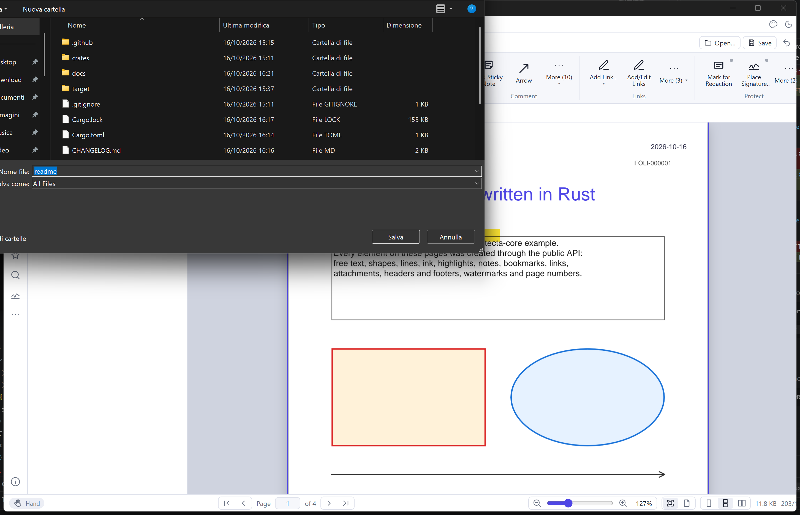

# Folitecta

**Folitecta** is a free PDF editor written entirely in Rust, with a modern desktop
interface built on [Dioxus](https://dioxuslabs.com). It renders pages with the pure-Rust
[hayro](https://github.com/LaurenzV/hayro) rasterizer and edits documents through the
[lopdf](https://github.com/J-F-Liu/lopdf) object model. The libraries it uses directly are free
software under MIT, Apache, GNU or Mozilla Public License 2.0 licences.



## Status: version 0.2.0 (pre-release)

Folitecta ships the **complete command surface of a professional PDF editor** — 1,981 commands
across a ribbon with 11 tabs and 64 groups, 9 classic menus, 27 side panes and a command palette —
so the whole feature set is discoverable. Each release turns more of those commands into working
operations; the rest are listed and open a roadmap notice. The exact state of every command is in
[docs/FEATURES.md](docs/FEATURES.md) (generated from the code) and in the in-app
**Feature matrix** dialog.

### Working today

- **Viewing**: tabs, continuous / single / two-page layouts, fit width / fit page / free zoom
  (`Ctrl`+wheel), view rotation, split window with two views of a document, full screen, light, white, dark and black themes, dark and
  high-contrast page modes, rulers (mm, cm, in, pt, pc), grid, guides with snapping, loupe with
  adjustable enlargement, the visible area outlined on the thumbnails, link
  and form-field highlighting, transparency grid, document info bar, page labels, view history.
- **Interface**: ribbon or classic menus and toolbars; the ribbon shows its tools as icons with a
  short name under each (View › Tool Names hides them) and the whole name in the tooltips; a Quick Access
  Toolbar of the user's own commands (a right click on a tool adds it), next to the tabs or below
  the ribbon; the side panes,
  the rows of the ribbon and the width of each ribbon group are changed by dragging their edges;
  pages drawn on several threads; document recovery after a window ended with unsaved changes.
- **Text and search**: text layer with mouse selection, copy, select all; search with match
  case, whole words and accents ignored, words near each other (adjacent, same paragraph, page or
  document) in separate colours, also in comments, bookmarks, form fields, document information,
  attachments and links, or through the PDF files of a folder; grouped results with
  previous/next navigation (`F3`); mark every result as highlight, underline, strikeout or
  redaction; word count; export to `.txt`.
- **Page text**: the Edit Text tool and the Insert, Replace and Delete Text commands of
  Edit › Text change the text drawn on the page (the rest of the line moves to make room);
  Find and Replace changes one occurrence or all of them in one undo step.
- **Text recognition (OCR)**: scanned pages, only the pictures in the pages, or an area read with
  PaddleOCR models run in pure Rust; English, Italian and 30 more languages of the Latin script.
  The text is written invisibly over the pages, so they can be searched and their text selected
  and copied; pictures can be made into a searchable document. Pages are read in the background
  with a progress bar and can be stopped.
- **Spelling**: Spell Check and Replace goes through the words of the page text, comments and
  form fields that the dictionaries do not know (English and Italian included, more Hunspell
  dictionaries can be added, several languages at once), with suggestions, change once or
  everywhere, ignore once or everywhere, and the user's own words; misspelled words are marked
  on the page while its text is edited.
- **Comments**: sticky notes (eleven icons), text boxes, callouts, typewriter text, rectangles, ellipses,
  polygons, polylines, clouds, lines, arrows (shown as they will look while drawn), smooth pencil
  strokes with eraser, area and free highlights, text highlight / underline / strikeout,
  insert-text and replace-text marks and text correction, stamps (presets, custom text, images),
  file attachments, links (web address, page, named destination, file to open, script), each with
  a generated appearance stream. Style editor (colour, fill, opacity, thickness, dashes, line
  endings, text size and alignment) with per-tool defaults, named comment styles with a palette,
  and style copy/paste. Select, move and resize with handles, nudge with the arrow keys, choose
  several with Shift to move, align, distribute, size alike and stack them, group them so they
  are chosen and moved together, copy / cut / paste across documents, flatten one or all,
  hide/show, delete.
- **Review**: replies, review states with history, check marks, filters, pop-up notes, comment
  summaries, export and import of comments as XFDF, FDF or PDF.
- **Sign**: digital signatures and certification with PKCS#12 digital IDs (RSA, ECDSA),
  self-signed IDs, validation against trusted certificates with separate checks of integrity,
  signer and time, time stamps (RFC 3161) of signatures and document time stamps from a time
  stamp server, incremental saving that keeps signatures valid; handwritten signatures and
  initials from a library.
- **Measure**: distance, perimeter and area with a calibrated scale, precision and separators,
  labels on the page, CSV export.
- **Forms**: draw text, check box, radio button, combo box, list box, button and signature
  fields; edit their properties, the items of choice fields (sorted or in any order) and the
  pictures of push buttons for each state; fill them on the page; fields calculated from others (sum,
  product, average, smallest, largest) in a chosen order; import and export values (XFDF, FDF,
  CSV, text); one filled copy per row of a table (Populate Forms); reset; tab order; field
  highlighting by kind.
- **Pages**: insert blank pages, pages of another PDF or pictures, delete (also empty pages),
  duplicate, extract, move by dragging thumbnails, swap, reverse, replace with pages of another
  file, rotate, crop by margins or to the visible content, resize, add margins, normalise sizes,
  cut along lines drawn over a page (split pages editor), rasterise, find duplicates, split a
  document, combine PDF files, pictures and text files from a list of source files.
- **Pictures**: the pictures of a page are selected on the page and edited in place or in a picture
  editor (quarter turns, mirroring, cropping, straightening of tilted scans, filters, gray, black
  and white, 256 colours) or in another app, once or everywhere the picture is drawn; replaced
  with a picture file or the clipboard.
- **Page marks**: watermarks, backgrounds, headers and footers with macros (`{page}`,
  `{pages}`, `{label}`, `{date}`, `{time}`, `{title}`, `{file}`, `{author}`, `{bookmark}` and
  more, with a macro guide), page numbering and Bates numbering (`{bates:6}`, continued across
  runs and several files), page labels (roman, letters, prefixes), page transitions, overlays and
  underlays from another PDF, removal of any mark Folitecta added.
- **Protect**: redaction (mark areas or text, apply to take the text, pictures, comments and
  form fields underneath out of the document while the rest of the page stays text, or draw the
  marked pages as pictures) with colour, blur or pixelated overlays, overlay text and sets of
  redaction codes; password protection with AES-128 and permissions kept when a protected file is
  saved, security policies (named sets of permissions, imported and exported), document script
  listing and removal.
- **Create and convert**: blank documents of any paper size, from pictures, from text files, from
  the clipboard; export pages to PNG/JPEG, extract embedded images; snapshot of an area to the
  clipboard; paste pictures onto pages and text as text boxes.
- **Barcodes**: QR Code, Data Matrix, PDF417, Aztec and linear barcodes (Code 128, Code 39,
  Code 93, EAN, UPC, ITF, Codabar) drawn on the pages; the barcodes of a document or of an area
  read and listed; web links made over the barcodes that hold an address.
- **Print**: page range, resolution, with or without comments, fit to paper, every open document.
- **Navigation data**: bookmark tree editing (drag and drop, styles, destinations, import and
  export), named destinations, links; layers (view visibility, defaults, groups, merge, flatten,
  extract, import); attachments (columns, open, save, edit); form fields (name groups, sorting,
  selection by type, manual tab order); signature fields.
- **Portfolios**: create portfolios from files, folders, details or tiles, columns and sorting,
  preview, file information, initial file, cover.
- **Accessibility**: automatic tagging, a tags pane with full editing (role map, class map, tags
  from a selection, artifacts), reading order with numbered boxes on the page, content pane,
  alternate text of figures, a 32-rule accessibility check with automatic fixes and a report.
- **Compare**: two documents compared word by word, differences highlighted on both, listed and
  visited, with a report document.
- **Stamps and tables**: stamps pane with collections and favourites, a stamp designer with
  templates and fields filled in at placement; tables drawn on the page and edited cell by cell.
- **History and sessions**: documents opened before with thumbnails and pins, sessions of open
  documents saved and opened again.
- **Calculator, scripts and media**: accounting calculator tapes on the page; a JavaScript console
  with snippets and named document scripts; sound and video comments with a media player.
- **Files and metadata**: an explorer pane with places, folder filters, thumbnails of PDF files and
  lists of files; rename, move or recycle the document file; metadata templates and XMP; guides
  saved to files.
- **Document tools**: typed or RTF text as pages, space usage audit, picture recompression,
  document scripts, pages split at guides or cut to the crop box, leaving PDF/A.
- **Interface**: ribbon or classic menus and toolbars that adapt to any window size, page
  layouts, pan and zoom window, touch mode, side panes, properties pane, command palette
  (`Ctrl+Shift+P`), undo/redo of every edit, English and Italian.

### Planned

Timestamped signatures, editing of the shapes of the page content, PDF/A conversion,
optimisation, cloud connectors, text recognition of scripts other than the Latin one and the
remaining commands listed as *planned* in the feature matrix.

## Download

Binaries for Windows (x64), Linux (x64) and macOS (Apple silicon and Intel) are attached to each
[GitHub release](https://github.com/KvasFan/Folitecta/releases); the
[GitLab releases](https://gitlab.com/tirael8308/folitecta/-/releases) carry the same versions. On
Linux the WebKitGTK 4.1 runtime must be installed (`libwebkit2gtk-4.1-0`, `libgtk-3-0`).

## Building from source

Requirements: Rust 1.92 or newer (stable) and the platform toolchain.

- **Windows**: Visual Studio Build Tools with the "Desktop development with C++" workload;
  the Edge WebView2 runtime (preinstalled on Windows 10/11).
- **Linux**: `libwebkit2gtk-4.1-dev libgtk-3-dev libxdo-dev libayatana-appindicator3-dev librsvg2-dev libssl-dev pkg-config`.
- **macOS**: Xcode command line tools.

```sh
cargo build --release
./target/release/folitecta my.pdf
```

Run the tests with `cargo test --workspace`, the lints with
`cargo clippy --workspace --all-targets -- -D warnings`, and regenerate the feature matrix with
`cargo run -p folitecta -- --features-md docs/FEATURES.md`.

`folitecta --ui-selftest <dir>` runs the interface self-test: it resizes the window through
several sizes, opens every ribbon tab, panes, menus and dialogs in both languages, checks the
layout for clipped or overlapping elements, simulates mouse and keyboard input on the canvas and
writes a report with a screenshot of every state (screenshots on Windows).

## Project layout

| Crate | Purpose |
|---|---|
| `crates/folitecta-core` | Document model (lopdf), page operations, comments and review, bookmarks, forms, attachments, layers, portfolios, links, text and search, spell checking, text recognition, page marks, stamps, tables, barcodes, comparison, tags and accessibility check, digital signatures, hayro render service, command registry |
| `crates/folitecta` | Dioxus desktop application: ribbon, menus, panes, canvas with drawing tools, dialogs, palette, localization; `assets/styles` holds the theme tokens and one style sheet per part, `assets/i18n` the translations |
| `dictionaries` | Hunspell spelling dictionaries (English, Italian), data files read at run time, each with its licence |
| `ocr` | Text recognition models (PaddleOCR, ONNX), data files read at run time, with their licence |
| `ai` | Guides for AI agents and contributors: target requirements, the state of each one, planned releases, workflow, progress log |

See [docs/ARCHITECTURE.md](docs/ARCHITECTURE.md) for the design,
[docs/FEATURES.md](docs/FEATURES.md) for the command-by-command status and
[ai/ROADMAP.md](ai/ROADMAP.md) for the roadmap.

## Licence

Folitecta is released under the [MIT License](LICENSE). Folitecta is an independent
implementation: it contains no code from, and is not affiliated with or endorsed by, any other
PDF product. The crates it depends on directly keep their own MIT, Apache-2.0, GNU or MPL-2.0
licences; their own dependencies may also use other permissive licences (BSD, ISC, Zlib,
Unicode) or the MPL-2.0. The allowed set is enforced by `deny.toml` (`cargo deny check licenses`).

The icons of the interface are [Tabler Icons](https://tabler.io/icons) (MIT License,
Copyright (c) 2020-2026 Paweł Kuna), used through the `icondata_tb` crate (MIT). Barcodes are
written and read with [rxing](https://github.com/rxing-core/rxing), the Rust port of ZXing
(Apache-2.0). Spelling is checked with [spellbook](https://github.com/helix-editor/spellbook)
(MPL-2.0). The spelling dictionaries in [`dictionaries/`](dictionaries/README.md) are separate
data files with their own licences: the English one from SCOWL (MIT-like and BSD licences), the
Italian one from the Italian Writing Aids extension by Andrea Pescetti and others (GNU GPL 3);
the release packages carry them in a `dictionaries` folder next to the program. Text is
recognized with [tract](https://github.com/sonos/tract) (MIT/Apache-2.0) running two models of
[PaddleOCR](https://github.com/PaddlePaddle/PaddleOCR) (Apache-2.0), kept in
[`ocr/`](ocr/README.md) with their licence and origin, and next to the program in the release
packages.
