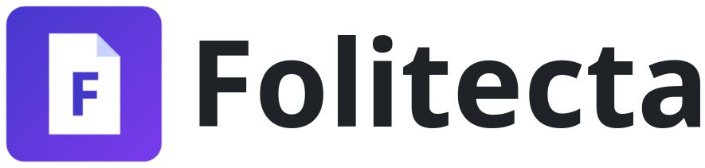
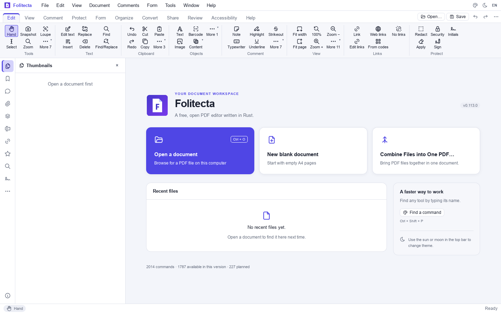
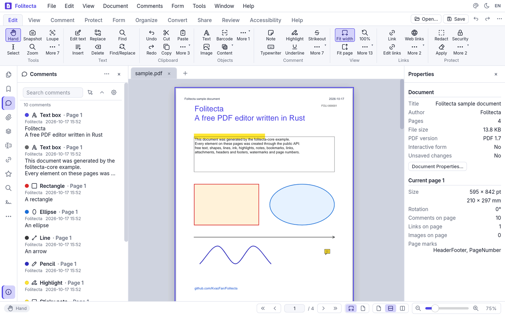
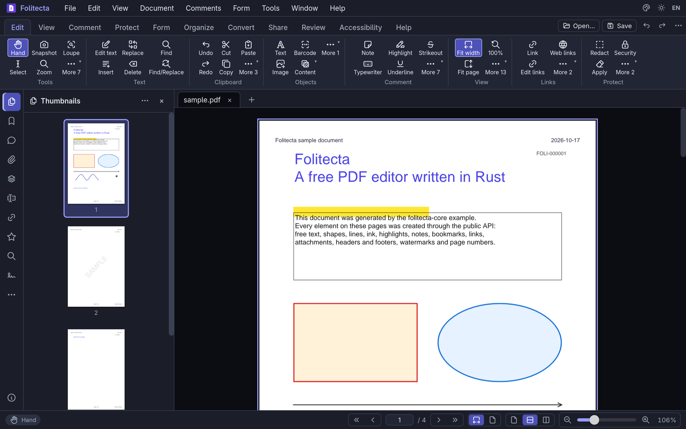
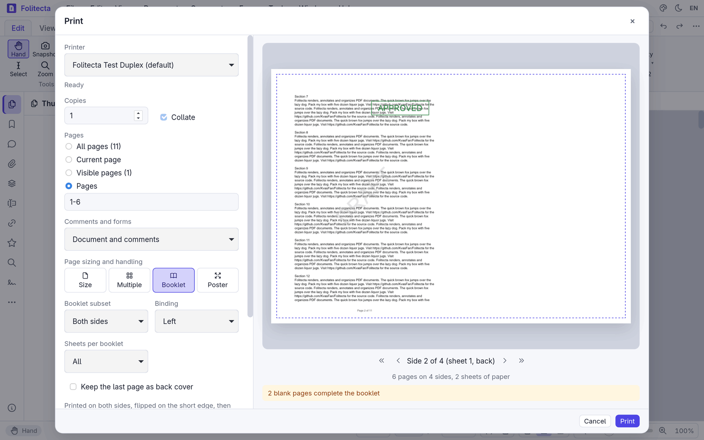
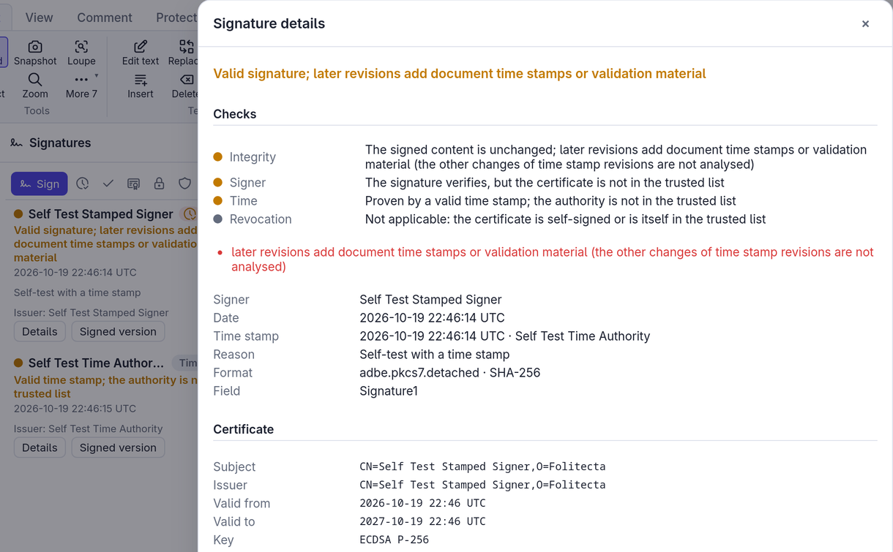

<p align="center">
  <picture>
    <source media="(prefers-color-scheme: dark)" srcset="docs/brand/folitecta-logo-white.png">
    
  </picture>
</p>

<h1 align="center">Make room for your documents.</h1>
<p align="center">A free PDF editor for your desktop. A lightweight PDF reader for Android.</p>
<p align="center"><b>No account. No subscription. Your files stay with you.</b></p>

<p align="center">
  <a href="https://github.com/KvasFan/Folitecta/releases/tag/v0.113.0"></a>
  <a href="LICENSE"></a>
</p>

<p align="center">
  <a href="#download">Download</a> · <a href="#a-workspace-for-every-step">Features</a> ·
  <a href="#android">Android</a> · <a href="#build-and-contribute">Build</a> ·
  <a href="docs/DESKTOP_GUIDE.md">Desktop guide</a> · <a href="CHANGELOG.md">Changelog</a>
</p>

> **Preview software · 0.113.0.** Desktop commands marked as planned show a notice;
> [the feature matrix](docs/FEATURES.md) documents each command. Android is a first reader release,
> with opening, reading and sharing; desktop editing tools are available on Windows, Linux and macOS.

## Download

Get the installers and their SHA-256 checksums from **[Folitecta 0.113.0](https://github.com/KvasFan/Folitecta/releases/tag/v0.113.0)**.

| Platform | Recommended download | Installation |
| --- | --- | --- |
| **Windows 10 / 11 · x64** | `folitecta-0.113.0-windows-x64-setup.exe` | Run the setup wizard. Includes Start menu shortcuts and an uninstaller; installs for your user. |
| **Linux · Debian / Ubuntu · x64** | `folitecta-0.113.0-linux-amd64.deb` | Run `sudo apt install ./folitecta-0.113.0-linux-amd64.deb`. Dependencies are installed automatically. |
| **Linux · other distributions · x64** | `folitecta-0.113.0-linux-x64.tar.gz` | Extract, install WebKitGTK 4.1 and run `./install.sh` to add the app to your menu. |
| **Android 8.0+ · phones and tablets** | `folitecta-0.113.0-android.apk` | Open the APK and allow installation from the app used to download it. |
| **macOS 11+ · Intel and Apple silicon** | [Previous desktop build · 0.73.0](https://github.com/KvasFan/Folitecta/releases/tag/v0.73.0) | Extract the app; on first launch use right click → Open. |

Windows also has a portable `.zip`. Linux needs glibc 2.35 or newer (Ubuntu 22.04 / Debian 12 or
newer); the `.deb` is for Debian-based distributions. On Fedora install `webkit2gtk4.1`, on Arch
install `webkit2gtk-4.1`. Keep the `fonts`, `ocr` and `dictionaries` folders with portable binaries.
Windows needs WebView2, normally present on Windows 10 and 11. The Windows installer is not code
signed and the macOS app is not notarized. Android APKs are signed with the project's release key. The 0.113.0 binaries cover Windows, Linux
and Android; the previous macOS build remains linked above.

## A workspace for every step

<p align="center">
  
</p>

| Read &amp; navigate | Edit &amp; review | Prepare &amp; share |
| --- | --- | --- |
| Tabs, bookmarks, thumbnails and search | Text boxes, highlights, shapes and comments | Combine, split, reorder and crop pages |
| Four themes and flexible page layouts | Forms, stamps, measurements and comparison | OCR, Office exports, signatures and protection |
| Ribbon, classic menus and command search | Layers and editing of page content | Print previews, booklets and email drafts |

Desktop operations use Rust with [hayro](https://github.com/LaurenzV/hayro),
[lopdf](https://github.com/J-F-Liu/lopdf) and [Dioxus](https://dioxuslabs.com).
The app writes saves through checked temporary files and preserves the encryption of protected
PDFs. See [known limitations](docs/ARCHITECTURE.md#known-limitations) before relying on advanced
features, and the [desktop guide](docs/DESKTOP_GUIDE.md) for the detailed feature list.

<details>
<summary><b>More desktop screenshots</b></summary>

| Comments and page tools | Dark theme |
| --- | --- |
|  |  |

| Print layout | Signatures |
| --- | --- |
|  |  |

</details>

## Android

A focused, offline reader with an interface designed for touch:

- Open PDF files from the system picker or another app.
- Browse pages, jump to a page number and zoom.
- Share a read-only PDF copy using the Android share sheet.
- English and Italian, with no account, network or broad storage permission.

This first Android version does not edit PDFs or open password-protected documents.
See [the Android guide](android/README.md) for builds and signing.

## Build and contribute

Desktop requirements: Rust 1.92+, the platform toolchain and, on Linux, WebKitGTK 4.1 / GTK 3
development libraries. Full instructions are in the [desktop guide](docs/DESKTOP_GUIDE.md#building-from-source).

```sh
git clone https://github.com/KvasFan/Folitecta.git
cd Folitecta
cargo build --release --locked -p folitecta
cargo test --workspace --locked
```

Android: JDK 17 or 21 and Android SDK 35, then `cd android && ./gradlew assembleDebug lint`.

[Contributing](CONTRIBUTING.md) · [Architecture](docs/ARCHITECTURE.md) ·
[Feature status](docs/FEATURES.md) · [Roadmap](ai/ROADMAP.md) · [Release packaging](packaging/README.md)

## License

[MIT](LICENSE). The desktop app includes third-party licence notices with every package.
Fonts, dictionaries and OCR models retain their own licences; the complete list of credits is
in the [desktop guide](docs/DESKTOP_GUIDE.md#license-and-credits).
